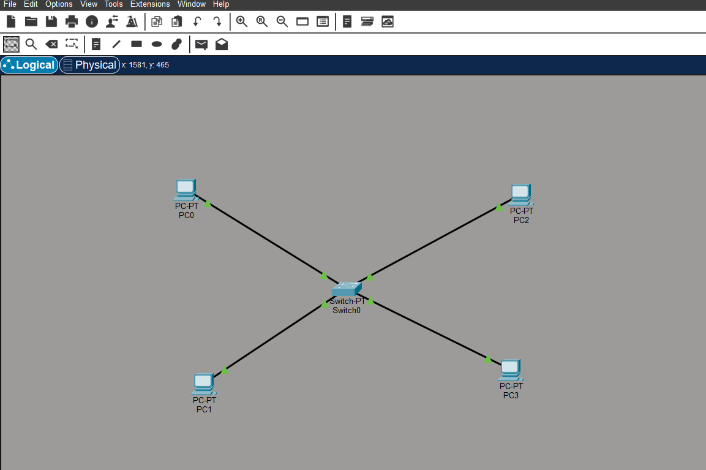
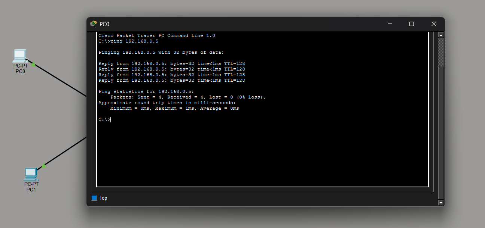
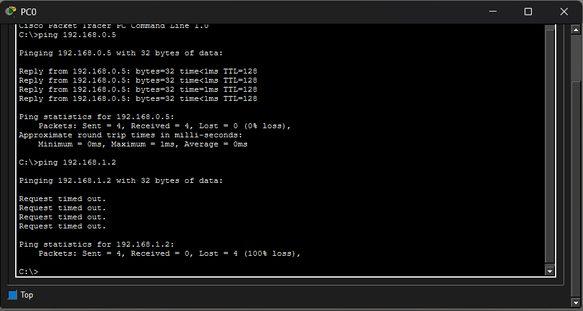
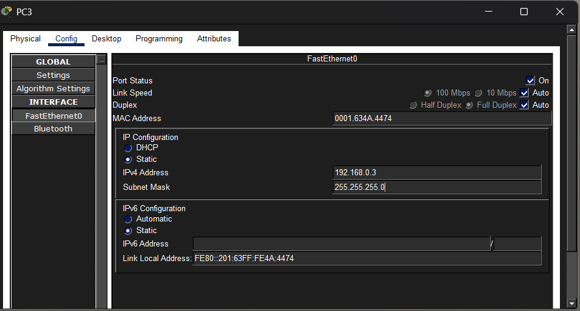
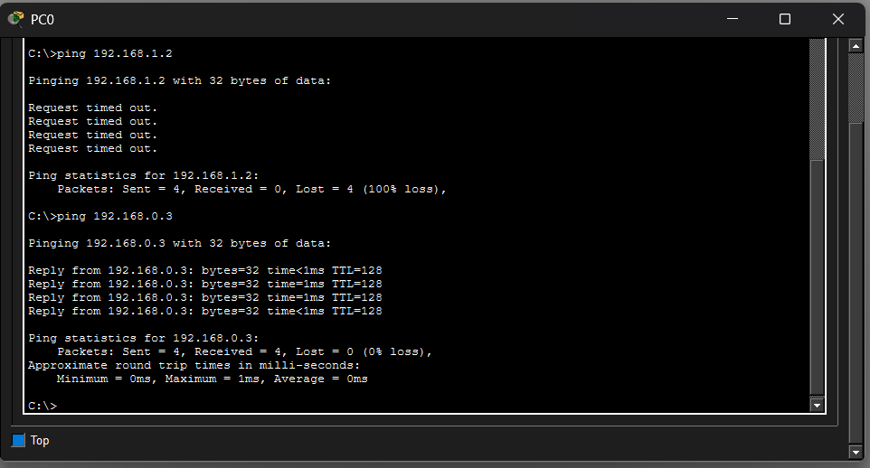

# First LAN Configuration

## Project Overview

This project consists of configuring a simple Local Area Network (LAN) using Cisco Packet Tracer.

The network contains four PCs connected to a central switch.

## Objectives

- Assign IPv4 addresses to each PC.
- Understand basic IP addressing.
- Test connectivity between devices using the Ping command.
- Identify connectivity problems caused by different IP networks.

## Practical Implementation

### 1. Initial IP Configuration

Four PCs were connected to a central switch and assigned the following IP addresses:

- PC0: 192.168.0.2
- PC1: 192.168.0.5
- PC2: 192.168.0.9
- PC3: 192.168.1.2

The first three PCs belonged to the same IP network, while the fourth PC belonged to a different network.

### 2. Connectivity Testing

Ping commands were used to test communication between the PCs.

- Communication between PCs in the same network was successful.
- Communication between PC0 and PC3 failed because they belonged to different IP networks.

### 3. IP Address Modification

The IP address of PC3 was changed to an available address in the same network as the other PCs.

After this modification, the ping tests were successful.

## Tools and Technologies

- Cisco Packet Tracer
- IPv4 Addressing
- Ethernet Switch
- ICMP (Ping)

## Conclusion

This practical exercise helped me understand the importance of correct IP addressing and how different IP networks affect communication between devices.

## Screenshots

### 1. Network Topology

### 2. Successful Ping Between PC0 and PC1

### 3. Failed Ping Between PC0 and PC3

### 4. IP Address Modification

PC3's IP address was changed to `192.168.0.3` to place it in the same network as the other PCs.

### 5. Successful Ping After IP Modification

